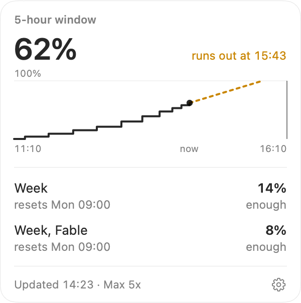

# Spool

[](https://github.com/dpaguba/spool/releases/latest)
[](#requirements)
[](LICENSE)

Spool is a native macOS menu bar app that shows how much of your Claude subscription budget you have used, and whether the rest will last until the window resets at your current pace.




## What it does

- A menu bar item with the used share of the 5-hour limit and a pace forecast: it tells you whether the rest lasts until the reset, or when it will run out.
- A panel with the 5-hour and weekly limits, reset times and the forecast. The menu bar and the top of the panel always show the 5-hour limit; the weekly limit is the row below (it takes the top only when there is no 5-hour limit).
- Notifications when the 5-hour window crosses 50% and 90% used. Thresholds are editable in Settings.
- Optional OpenAI Codex limits next to the Claude ones.

Spool is built for one person's daily use and published as open source. Pull requests are welcome.

## Requirements

- macOS 26 or later, on Apple silicon or Intel
- Claude Code, signed in with a Claude subscription

## Install

1. Download the zip from the [latest release](https://github.com/dpaguba/spool/releases/latest) and unzip it.
2. Move `Spool.app` to `/Applications` before you open it. An app opened straight from Downloads runs from a temporary copy, and Claude Code would remember that copy's helper path.
3. Open it. Spool is not notarized, so macOS blocks the first launch. Then open System Settings → Privacy & Security, scroll to the message about Spool and click Open Anyway. Or run this once in Terminal instead:

   ```sh
   xattr -dr com.apple.quarantine /Applications/Spool.app
   ```

4. Spool has no Dock icon. Click the ring in the menu bar and press Connect Claude Code. Your limits appear after the next Claude Code reply.

To uninstall, press Disconnect in Settings first (see below), then delete the app.

## Build from source

You need Xcode 27 or a Swift 6 toolchain, and no Apple Developer account: the build is ad-hoc signed and not notarized.

```sh
export DEVELOPER_DIR=/Applications/Xcode.app/Contents/Developer   # if xcode-select points to the Command Line Tools
scripts/build-app.sh release
open build/Spool.app
```

The script builds the package, generates the app icon, checks that the English and Ukrainian strings have the same keys, assembles `build/Spool.app` and signs it ad hoc. Release builds are universal (Apple silicon and Intel), debug builds are native. It keeps a `DEVELOPER_DIR` you set; otherwise it uses `/Applications/Xcode.app/Contents/Developer` when that exists, and leaves the toolchain choice to `xcode-select` when it does not. Run `swift test` for the tests.

## How the Claude Code connection works

Claude Code runs the command set as `statusLine` in `~/.claude/settings.json` after each assistant message and passes a JSON document on stdin. It includes `rate_limits.five_hour` and `rate_limits.seven_day`.

Spool ships a small helper, `spool-statusline`, inside the app bundle.

- "Connect Claude Code" in the panel, or Connect in Settings, backs up `settings.json`, then sets the helper (its path quoted for the shell) as the `statusLine` command. Every other key is preserved.
- The helper reads stdin, writes the observed values into Spool's data directory and prints nothing. On any error it exits 0 with no output, so it cannot break Claude Code.
- If a `statusLine` is already configured, Spool replaces the entry, saves the previous one, and runs it through the helper: the helper runs the previous command with the same input and prints its output (chaining).
- "Disconnect" restores the previous `statusLine` value, or removes the key if there was none.
- Before connect, disconnect or repair changes `settings.json`, Spool copies it to `~/Library/Application Support/Spool/backups/settings-<timestamp>.json`. The previous `statusLine` is kept in `~/Library/Application Support/Spool/chain.json` until you disconnect.
- Spool always edits `~/.claude/settings.json`. `CLAUDE_CONFIG_DIR` is not supported for the settings file.
- Disconnect in Spool before deleting or moving the app. Otherwise Claude Code keeps running a helper that is no longer there.
- If you move the app anyway, the stored helper path breaks. Spool checks the connection each time it recomputes: at launch, every 15 minutes, and when the panel or Settings opens. The panel then shows "Connection needs repair" with a Repair button, and Settings offers Repair too. If Claude Code's `/statusline` or another tool replaces the line, the panel says "Claude Code not connected" with a Connect button, unless Detailed limits still supplies Claude data.

Values update only while Claude Code is generating, which is when the budget is spent. Within one window usage only grows, so Spool keeps the highest observed value per window.

## Detailed limits (optional, off by default)

Turning this on adds per-model weekly limits, the plan name, and fresh numbers while Claude Code is idle.

- Spool reads the OAuth token that Claude Code stores (Keychain item `Claude Code-credentials`, or `~/.claude/.credentials.json`) and calls `GET https://api.anthropic.com/api/oauth/usage` with it.
- Read only. Spool never refreshes the token and never writes to the Keychain item or the file. If the token has expired, Spool pauses until Claude Code refreshes its login.
- At most one request per 15 minutes, with back-off on errors and respect for `Retry-After`.
- The risk, in plain words: Anthropic says subscription OAuth is meant for Claude Code and its own apps. A read-only usage monitor sits in a grey area. The risk is small but not zero, and it is your choice. The switch in Settings carries the same text.
- macOS may show a Keychain access prompt for this item.

The default statusline route touches no credentials.

## Codex

Turn on OpenAI Codex in Settings (off by default) to see Codex limits next to the Claude ones. Spool then reads `$CODEX_HOME/auth.json` (default `~/.codex/auth.json`), or the Keychain item `Codex Auth` when Codex is set to keyring storage. Read only, never refreshed. It calls `https://chatgpt.com/backend-api/wham/usage`, which is an undocumented endpoint that OpenAI's sign-in docs ask apps not to call, so treat it as a grey area too. This path has not been tested against a live account.

## Where data lives

`~/Library/Application Support/Spool/` holds the observations written by the helper (`observations.jsonl`) and Spool's own state. `backups/` holds a copy of `settings.json` from before each change Spool made to it, and `chain.json` the previous `statusLine` while Spool is connected.

## Environment variables (development)

| Variable | Effect |
| --- | --- |
| `SPOOL_DATA_DIR` | Use this directory instead of `~/Library/Application Support/Spool/`. |
| `SPOOL_CLAUDE_SETTINGS` | Use this file instead of `~/.claude/settings.json` for connect and disconnect. |
| `SPOOL_CLAUDE_CREDENTIALS` | Read Claude credentials only from this file, never from the Keychain or Claude Code's own file. |
| `SPOOL_CODEX_KEYCHAIN_SERVICE` | Keychain service name for Codex credentials instead of `Codex Auth` (for throwaway test items). |
| `SPOOL_DEBUG=1` | Writes diagnostics to stderr and enables the flags below. |

With `SPOOL_DEBUG=1`:

- `--open-panel` opens the panel at launch.
- `--debug-action <name>` (repeatable, run in order) runs what the Settings window runs and logs the result. Names: `open-settings`, `close-settings`, `connect`, `disconnect`, `repair`, `login-on`, `login-off`.
- `kill -USR1 <pid>` runs the checks of the enabled optional sources, as opening the panel does.

Tests and experiments should always use the overrides, so they never touch your real `~/.claude/settings.json`.

## Verification status

Verified:

- The statusline payload shape (`rate_limits`, `used_percentage`, `resets_at`) on Claude Code 2.1.322 (2026-11-10).
- Launch at login registers and unregisters with the ad-hoc signed build. A real start at login has not been tested yet.

Not yet verified:

- Notification delivery for an ad-hoc signed, non-notarized app.
- Keychain prompt behaviour for `Claude Code-credentials`.
- The scale of `limits[].percent` in the usage response.
- The Codex Keychain account hash and payload format.
- Live Codex responses. `chatgpt.com` answered HTTP 403 to a test token.

## Background

No official API for subscription limits exists at Anthropic or OpenAI. Anthropic's terms say subscription OAuth is for Claude Code and Anthropic's apps, and consumer terms forbid automated access, so Spool does not use claude.ai web login. For the same reasons, and because the App Sandbox cannot read another developer's Keychain items, Spool is not on the App Store. Similar tools: CodexBar, ClaudeBar, Claude Usage Tracker, ccusage.

## Disclaimer

Spool is not affiliated with Anthropic or OpenAI. "Claude", "Claude Code", "Codex" and "OpenAI" appear only to name the data sources.

## Licence

MIT, see [LICENSE](LICENSE).
